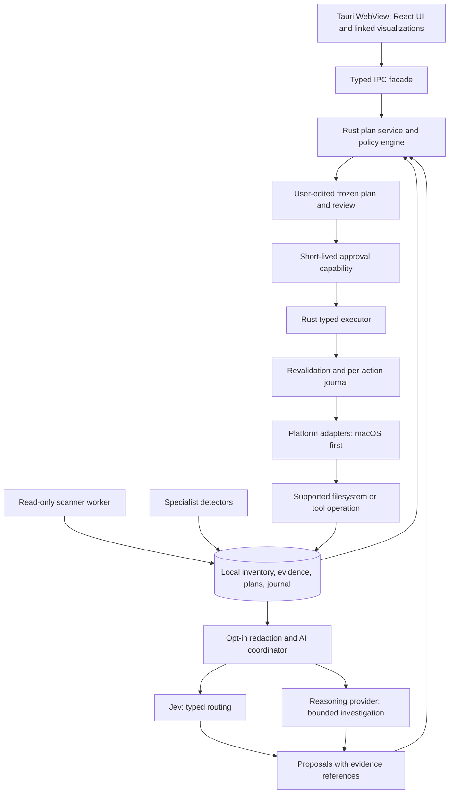

# Architecture and interaction design

## 1. Product decisions

Build a cross-platform desktop app, working name Disk Steward, using Tauri 2 and a shared Rust core. The first supported release targets macOS; Windows and Linux follow through separately validated platform adapters. The primary deliverable is an editable cleanup plan with evidence. Inventory is comprehensive within permitted scopes; deletion support is deliberately narrower. User approval is necessary but does not override an unsupported operation or failed invariant.

Proposed baseline: Tauri 2; React, TypeScript, and Vite; Rust domain/core crates; SQLite through rusqlite with a serialized writer. D3 computes treemap/partition layouts and chart scales; React owns UI/state and SVG output. Use bounded Canvas rendering only if profiling proves it necessary, retaining accessible DOM/list equivalents. Provisionally target macOS 14+ on Apple Silicon and Intel; confirm framework/toolchain/WebView prerequisites, platform integration, and performance in M0. Lock compatible dependencies at implementation time. Node is development tooling, not an application sidecar. Tauri separates a Rust core and system-WebView frontend. [Tauri process model](https://v2.tauri.app/concept/process-model/)

Distribute directly with Developer ID signing, hardened runtime, and notarization. The platform spike must compare scoped-folder App Sandbox operation against the access needs of a whole-disk utility and Git subprocesses. Do not assume Full Disk Access removes sandbox restrictions. No root helper, permission bypass, or silent entitlement expansion. A selected-folder mode must remain useful when broad access is declined. Apple documents both persistent scoped access and independent permission failures. [Apple filesystem access](https://developer.apple.com/documentation/security/accessing-files-from-the-macos-app-sandbox)

## 2. Components and authority



| Module | Responsibilities | Explicit limitations |
|---|---|---|
| AppUI | React selection, navigation, visual comparison, plan edits, approval requests | No direct filesystem, shell, SQL, provider credentials, or execution authority |
| InventoryCore | Identity, traversal, sizes, checkpoints, coverage | Does not follow links/cross volumes by default |
| DetectorKit | Versioned detectors and evidence | Cannot execute proposed cleanup |
| GitInspector | Repository graph, local state, remote verification | No implicit fetch/push/maintenance in source clones |
| Intelligence | Redaction, Jev routing, bounded reasoning, review | Cannot approve actions or access executor |
| PlanCore | Revisions, exclusions, conflicts, estimates, policy | Cannot convert unknown evidence into eligibility |
| ExecutionService | Approved typed actions, checks, journaling | No arbitrary path/shell API; no root |
| RecoveryService | Receipts, Trash restoration, collisions | No promise of universal undo |

The Rust backend owns approvals, credentials, database writes, path resolution, and execution. Use an explicit allowlist of custom Tauri command permissions per window; do not expose generic filesystem/shell/SQL plugins to the renderer. Tauri capabilities constrain frontend access, not `std::fs` calls inside Rust; every custom command independently validates scope, item identity, arguments, manifest, and policy. Avoid broad capability unions and remote-content command access. [Tauri capabilities](https://v2.tauri.app/security/capabilities/), [Tauri filesystem plugin](https://v2.tauri.app/plugin/file-system/)

Bundle frontend assets locally; use restrictive CSP, no remote scripts, no renderer provider requests, no arbitrary local-file asset scope, and text-safe rendering of filenames, diffs, and model output. Previewing active HTML/SVG or other untrusted documents must not inherit application capabilities. Scope event channels and serialize bounded pages/aggregates instead of streaming millions of paths into the WebView.

Isolate expensive parsers/scanners in Rust workers and separate native processes where justified; macOS may use an XPC bridge for a sandboxed parser/execution boundary if M0 validates the benefit. Same-user processes can retain ambient filesystem authority; a sidecar is not automatically a sandbox. Restrict protocols, authenticate peers, minimize inherited handles/env, and test that model-facing tools cannot reach execution. No frontend shell permission to launch workers.

### Shared core and OS adapters

Shared crates: `inventory-core`, `detectors`, `git-analysis`, `intelligence`, `plan-core`, `journal`, and a small IPC DTO/schema crate. `platform` exposes scope grants, lossless path/identity, allocation measurements, no-follow traversal, notifications, secure credentials, Trash/restore, native confirmation, and package ownership. Implement `platform-macos` first; provide Windows/Linux compile-time contracts and fixtures from the start.

Backend commands include `start_scan(scopeGrantIds)`, `get_children(itemId, cursor)`, `get_storage_view(query)`, `edit_plan(revision, edits)`, `investigate(itemId, consent)`, `review_plan(revision)`, `request_execution(reviewId)`, and `restore(receiptId)`. These are design contracts, not generated arbitrary filesystem methods. The backend resolves IDs and owns the actual manifest. Use paged responses and bounded progress channels; do not put secrets or full content into broad events.

An execution request opens an OS-native confirmation, populated from the backend's frozen plan, showing action counts, destinations, size estimate, and consequences with access to the exact manifest. This reduces the consequences of a compromised renderer misrepresenting approval; a tiny native confirmation alone does not guarantee a truthful detailed review. Validate the full approval surface in M0.

| Portable behavior | Platform-specific work |
|---|---|
| Plan revisions, evidence, policies, AI orchestration, most Git graph analysis | Permission grants and credential integration |
| Duplicate grouping and content comparison | File IDs, Unix byte paths / Windows wide paths, case and link semantics |
| Shared charts and review interactions | Keyboard/menu conventions, accessibility in each system WebView |
| Cleanup detector framework | Actual cache locations, package managers, ownership and active-use checks |
| Journaling and recovery contracts | Trash/Recycle Bin, restoration metadata, volume behavior, native execution |
| Size aggregation contracts | APFS sharing/snapshots, NTFS allocation/reparse points, Linux filesystem differences |

macOS needs APFS/TCC/FSEvents/Keychain-specific adapters; Windows needs NTFS/reparse/open-handle/Recycle Bin handling; Linux needs mount/XDG Trash/permission/keyring handling. These are engineering requirements to validate, not claims that a generic cross-platform crate solves them. Never enable an unsupported action via an OS string check alone. Tauri retains native signing and packaging requirements. [Tauri distribution](https://v2.tauri.app/distribute/)

### Platform profiles and shared behavior

Keep the user experience, planner, reasoning loop, Jev integration, detector framework, Git analysis, and history largely identical across operating systems. Platform differences enter through three explicit interfaces: declarative platform profiles, small native integration/operation adapters, and versioned detector catalogs. Do not fork the application or maintain separate reasoning workflows per OS.

`PlatformProfile` supplies detected OS/version, relevant filesystem/volume properties, conventional directory roles, protected/excluded scopes, supported package/tool integrations, available evidence collectors, and available cleanup actions. It includes prompt guidance for what to investigate on that platform and how to interpret common storage categories. Populate it from detected facts and maintained definitions, not a model's guess; unusual installations and mixed-volume behavior remain explicit unknowns. Send only the consented/redacted subset to remote providers.

Derive Jev and reasoning context from this profile, but enforce protected scopes and executable-action prerequisites in backend policy as well. A prompt saying a folder is protected does not prevent a mistaken action; conversely, a model's claim that a folder is disposable does not satisfy an action prerequisite. Installation-baseline absence is an inventory clue, not a deletion rule. The profile can suggest which collector to run; the collector and native adapter must still establish the facts and execute correctly.

Use shared scenario tests for the same review/edit/approve flow across OSes, plus focused native-adapter tests for permission, identity, links, deletion, recovery, and accounting. Prefer a narrow shared adapter contract over scattering OS conditionals throughout the UI and agent loop.

## 3. Durable data and contracts

SQLite schema, with migration tests:

- `ScanSession`: selected scope IDs, exclusions, version, status, budget, checkpoints, coverage counts, start/end.
- `InventoryItem`: scan ID, parent ID, volume/resource identity, raw filesystem name/URL representation, kind, logical/allocated bytes, mtime/change observation, link count, cloud availability, bundle/library boundary. Preserve byte-safe identities where string normalization is lossy.
- `Evidence`: subject IDs, observation type, structured payload, observed time, collector/version, freshness policy, unknowns. Sensitive payloads local only.
- `Finding`: category, subject IDs, detector/version, evidence IDs, suggested operation, blockers, estimate range, source (`detector`, `model`, `user`).
- `RepositoryAssessment`: worktree/common-dir graph, local state classes, ref coverage, metadata inventory, remote receipts, exclusions, verification level.
- `PlanRevision`: immutable ID, parent revision, user edits, policy/version, status, action manifest digest.
- `PlanAction`: typed operation, exact target IDs and exclusions, manifest, evidence prerequisites, recovery contract, estimated effect, dependencies/conflicts, review status.
- `Approval`: revision/digest, adapter versions, consent scope, issued/expiry timestamps, single-use execution ID. Internal capability, not a portable bearer token exported with a report.
- `ExecutionRecord`: action ID, intent, pre-state fingerprint, operation start, outcome/uncertain outcome, recovery locator, result observations.
- `DecisionTrace`: request ID, model/returned version, prompt/schema version, redacted input digest, evidence IDs, allowed choices, output, review result, usage. No hidden chain-of-thought collection.

Detector contract: `analyze(snapshot, budget) -> findings + requiredEvidence`. Findings contain item IDs, never executable commands. Operation adapters define eligibility checks, manifest generation, preflight, execution, reconciliation, and recovery. Rendering explanations must not change these contracts.

State flow: `draft → investigating → reviewable → approved → running → completed/partial/canceled`. A stale action returns to review. Editing an approved plan creates a new draft revision. A running revision cannot be edited; changes become a separate plan. Restart does not resume destructive actions automatically.

## 4. Scanner and accounting

Enumerate metadata first using bounded batches. Store child records incrementally and aggregate directory sizes without loading the entire tree. Treat known bundles and managed libraries as typed boundaries; do not hide their size. Unknown directories remain traversable. Hard links use shared identities; symlinks are recorded without dereference. Parent/child proposals conflict unless the parent explicitly excludes those children.

Deep work is staged: candidate grouping by size/type, sample hashes, full content verification where useful. Hashing is streaming and low priority. No cloud placeholder hydration by default. Archive inspection never extracts executable content; enforce entry-count, expanded-size, ratio, nesting, time, and memory limits. Unsupported/encrypted archives remain unresolved.

Use FSEvents as invalidation hints after a scan, not authoritative proof that nothing changed. Revalidate before operations. APFS clones/compression/snapshots make summed file sizes an imperfect recovery estimate. Display ranges/unknowns, account for hard links and overlap, and measure per-volume free-space change after execution with an observation window. Label this an observed change, since other processes also write. Same-volume Trash/staging is pending removal, not recovered space.

Initial engineering targets, to verify on declared reference hardware and fixtures: first useful findings within 10 seconds on a warm local selected-folder scan; scan worker under 300 MiB RSS on a one-million-item metadata fixture; combined app memory under 600 MiB; UI input latency p95 under 100 ms during scan; cancellation acknowledged within one second between noninterruptible system calls. Start with two metadata jobs and one deep-analysis job, adjust from measurements. Pause deep analysis if local database free-space reserve falls below the greater of 1 GiB or projected checkpoint needs. Database size is budgeted; never promise a full scan under insufficient storage.

## 5. Detector library and MVP eligibility

Detectors are bundled, versioned code/data. Future downloaded definitions must be signed and cannot inject executable commands. Every cleanup adapter includes valuable-file-in-disposable-folder fixtures.

MVP detectors:

1. Developer outputs: a small documented allowlist of project/output combinations, including generated output that can be substantiated. Dependency installations with unknown local modifications remain review-only; an ignore rule alone is insufficient.
2. Application caches: a short catalog of verified disposable categories with owner/running-process checks. Generic `Library/Caches` removal is not an action.
3. Installers: identify packages/disk images and installed-owner evidence; default to a review suggestion, never infer obsolescence solely from age.
4. Large files and directories: discovery and user-added review. Managed stores, unfamiliar folders, and unsupported types are not generic recursive deletion targets.
5. Exact duplicates: size/hash grouping followed by stable content verification; explicit survivor, location/role disclosure, no auto-selection of managed library members.
6. Git clones: classification and narrowly supported clone-to-Trash actions as below.

MVP operations: `stageVerifiedFiles`, `stageSupportedGeneratedTree`, `stageVerifiedStandaloneClone`, `restoreStagedItems`, and separately approved `permanentlyRemoveRecordedStagedItems`. M0 chooses and validates the holding mechanism: native Trash where exact receipt-based restoration and selective permanent removal are supportable, otherwise an explicitly labeled app-managed recoverable holding area. The UI must say which mechanism is actually used. No arbitrary recursive `rm`, automatic expiry/purge, unrelated Trash emptying, package uninstall hooks, or source-tree writes in discovery.

The exact initial tool/category scope and executable minimum are defined in the [MVP catalog](../../../MVP-CATALOG.md). M0 freezes supported tool versions, roots, evidence, negative fixtures, and the executable subset. In particular, recognizing a familiar output directory cannot substitute for verifying the selected contents. M3 must deliver at least two generated-data/cache families and exact-duplicate cleanup, not merely discovery cards.

For user-added unsupported items, expose Reveal in Finder and the reason the app cannot safely execute. User intent remains represented without pretending the adapter exists.

## 6. Git: assess recoverability, not age

### Discovery and activity

Find `.git` directories and gitfiles; resolve through Git, including common directories, worktrees, submodules, alternates, and nested repositories. Do not assume `.git` is a self-contained folder. Git documents shared state across linked worktrees. [Git worktrees](https://git-scm.com/docs/git-worktree)

Activity is a ranking signal combining observed worktree changes, reflog events, and optional user pinning. Last commit time describes history, not last use. Use “No recent activity observed; evidence incomplete” when appropriate. A configurable 90-day threshold is a product default, not a safety rule.

### Evidence required before clone removal

- Enumerate staged/unstaged changes and all untracked/ignored data. `git status` normally omits ignored material; request it explicitly and reconcile with inventory coverage. `.env`, local datasets, certificates, and notes are not disposable because they are ignored. [Git status](https://git-scm.com/docs/git-status)
- Enumerate all local branches/tags/other refs, detached HEAD, stashes, and relevant reflog/unreachable recovery state. Unknown or expensive incomplete analysis blocks the clean-clone classification.
- Inventory hooks, configuration, local excludes, attributes, rerere data, and other local state. Generated metadata may be disposable; unknown customization requires review/preservation.
- Detect ongoing merge/rebase/bisect/cherry-pick, lock files, nested repos, LFS, partial/shallow/sparse clones, alternates, and linked worktrees. These are visible but blocked from executable clone removal in MVP unless an explicitly tested exception is added.
- Verify remote access and relevant commit/ref coverage now. Cached remote refs are not enough. Read advertised refs, then use a temporary app-owned bare verification store when graph evidence is required. Network collection must not mutate the source repo or run its hooks/configured arbitrary transports.
- The MVP Git acceptance scope is public GitHub HTTPS plus private GitHub HTTPS using an app-mediated credential broker and macOS Keychain. M0 proves the transport/authentication implementation, including revocation and secret handling. Do not use arbitrary repository-configured helpers or credentials embedded in URLs/arguments. SSH, other hosts, Enterprise, and custom transports remain visibly unsupported initially. Offer user-reviewed endpoint selection where applicable, never silently rewrite a remote. Public-only tests cannot satisfy M4's private-repository gate. Full scope and resource limits are defined in the [MVP catalog](../../../MVP-CATALOG.md).
- Prove that relevant local tips/commits are reachable from freshly verified remote refs and disclose local ref names that would not be reconstructed. In the isolated verification store, verify required commit/tree/blob object completeness and integrity; an advertised SHA or an existing object in a source clone is not sufficient proof. Preserve local ref identities in an explicitly selected recovery package or require an explicit decision. A local tag name or branch name can be valuable even when its commit exists remotely.
- For recoverable reflog/unreachable state, preserve it with a verified recovery method or require an explicit, separately described discard decision; never silently treat it as worthless.
- Revalidate the whole relevant manifest and remote receipt immediately before removal. Default remote receipt expiry: 15 minutes; force re-verification after ref/content changes. Remote retention remains outside the app's guarantee.

Status labels: `Keep pinned`, `Needs remote verification`, `Local-only material`, `Complex layout`, `Ready for reviewed removal`, `Changed since review`. Avoid “safely backed up” when the evidence only proves current remote availability.

An ordinary clone can be eligible after every local-state class has an explicit disposition. If preservation cannot be verified, it stays blocked. An external archive destination can preserve more than Git history, but copying bytes alone is not proof: require manifest verification and a recovery test where feasible.

Remote verification is a budgeted job, not an unbounded fetch. Starting defaults: one concurrent job; 2 GiB network ingress and temporary storage per repository; 4 GiB aggregate live verification stores; at least 2 GiB remaining free space plus checkpoint headroom; five minutes per attempt. M0 calibrates and freezes these limits and proves enforcement, including cancellation overshoot. Preflight and continuously monitor the chosen volume; all cached/partial stores count. Stop with an explicit incomplete-verification blocker on any limit, and do not retry a full download automatically. Journal store ownership; remove abandoned/partial app-owned stores after workers stop and reconcile on restart. Never mutate the source clone. Allow an explicitly selected alternative verification volume without waiving the limits.

### Commit and push (P1)

Provide a guided preservation workflow separate from cleanup execution: select exact files/hunks, show local diff and ignored/untracked warnings, choose repository/branch/destination, review commit message, scan for likely secrets locally, and confirm publication. Secret scanning is advisory and cannot guarantee absence. Never stage everything automatically, force push, or bypass branch protection. User-installed hooks can execute code; show and obtain explicit authorization before invoking them, or hand off to the user's Git client. Do not silently disable signing or hooks to make a push succeed.

After push, independently verify remote refs and required objects; re-assess ignored files, stashes, custom configuration, and remaining local-only refs. Produce a new cleanup proposal with a new approval. Failure/cancellation cannot fall through to deletion.

### Reducing Git storage while keeping the repository (P1)

Break down objects/packfiles, LFS objects, working-tree/generated files, and other state. `git count-objects -v` provides object-storage measurements. [Git object accounting](https://git-scm.com/docs/git-count-objects)

Offer supported housekeeping only when useful: conservative repacking with no deliberate object expiry first; vetted normal maintenance later with its retention consequences disclosed. Never default to aggressive GC, `prune=now`, reflog expiration, history rewriting, or direct deletion inside `.git`. GC can remove recovery state and has concurrency considerations. [Git garbage collection](https://git-scm.com/docs/git-gc)

Local merged-branch cleanup is organizational first: branch refs are small and objects remain reachable from other refs/reflogs. Do not promise meaningful immediate savings or equate merged with unwanted. Preserve branch identity in an undo receipt before explicit deletion. Never delete remote branches as disk cleanup.

LFS pruning needs its own remote verification and dry-run adapter, with shared-store detection. Stale worktree removal needs graph-aware Git operations. A shallow re-clone is a separately reviewed replacement workflow with restricted history, never an in-place space-saving default. A Git bundle preserves selected Git objects/refs, not working files, ignored data, hooks, config, or LFS payloads; bundle restoration must be tested and supplemental material preserved separately. [Git bundles](https://git-scm.com/docs/git-bundle), [LFS prune specification](https://github.com/git-lfs/git-lfs/blob/main/docs/man/git-lfs-prune.adoc)

## 7. Jev integration and bounded reasoning

Use a Rust HTTP client against an isolated provider adapter; API keys and model requests never enter the renderer. OpenRouter currently documents `POST /api/alpha/decisions` and pinned `typesafe/jev-1.14`. Verify the contract and supported model at implementation; treat the alpha endpoint as replaceable. Request state is structured evidence, with choice criteria fixed by the app. Store the returned model build when provided. This orchestration is shared across operating systems; the available evidence collectors and actions come from platform adapters. [OpenRouter Jev guide](https://openrouter.ai/blog/insights/what-is-jev/)

Example application-level input (adapter maps to current provider schema):

```json
{
  "subject": "item-184",
  "facts": {"category": "unknown-project-data", "allocatedBytes": 8450000000},
  "evidenceIds": ["ev-22", "ev-24"],
  "unknowns": ["owner", "reproducibility"],
  "allowedRoutes": ["keep", "inspect_metadata", "run_specialist", "reasoning_review", "ask_user"]
}
```

Jev does not author rationale or prove safety. Explanations come from evidence templates or a reasoning model with verified evidence citations. Confidence describes concentration among choices, not correctness on this disk. Missing/invalid probability fields, timeouts, provider changes, and rate limits route to deterministic handling or unresolved review, never permission to execute.

Cache by redacted evidence digest, model/schema/prompt/policy version, never by path alone. Invalidate on changed evidence. Start with opt-in per scan, a visible request/spend budget, bounded concurrency, and a cancel switch. Exact pricing is read from the provider during implementation rather than hardcoded into this plan.

Reasoning tools: list bounded inventory children; read allowed metadata; inspect a size-limited, consented content sample; request a named specialist; propose an action by inventory IDs; ask a user question. No shell, executor, arbitrary URL fetch, or unrestricted file reads. Treat filename/content instructions as untrusted. Require a separate evidence-first review for AI-origin actions; reviewer receives observations before the proposal and records agreement, rejection, or missing evidence. It cannot waive policy blockers.

Run an early, bounded AI feasibility evaluation in M0; production model integration still begins in shadow mode in M5. Use 100 human-labeled synthetic or separately consented cases: 40 generated/cache, 20 Git, 20 personal/duplicate, and 20 ambiguous/adversarial. Split 60 development and 40 held-out cases by scenario/template family, not neighboring files; hold back the latter until M5. Inspect labels independently of model recommendations. Initial M0 live evaluation uses the development set, a $15 maximum model-spend budget (or the user's lower limit), and a bounded request count; credentials/consent are explicit dependencies, and mocked responses do not establish model usefulness.

Record correct routing, unsupported cleanup proposals, fabricated evidence references, useful next investigation, escalation rate, cost, and latency against a deterministic-only baseline. Initial feasibility targets: at least 85% agreement on development routing labels, no unsupported action/evidence accepted by the policy layer, and useful evidence-based next steps in at least three of five nominated unfamiliar-folder investigations. These are pilot criteria, not statistical safety claims. M0 records whether to retain/change the model, evidence format, or route set; it does not waive execution checks. If evaluation access is unavailable, report the unresolved AI gate while unrelated foundation work proceeds; do not claim evaluation passed.

M5 repeats the evaluation on the held-out set, requires the same frozen routing/validity gates, measures investigation benefit over the baseline, and reports failures rather than reusing development scores. Evidence-format changes discovered in M0 feed M1 contracts. Pin model/schema/prompt versions per run; model updates do not change existing plans silently. No confidence threshold authorizes deletion.

## 8. Visual design and navigation

Use a desktop utility with a rich, expressive, colorful storage map: compact platform-appropriate chrome, a spacious visual workspace, and a contextual evidence inspector. Sidebar destinations: Overview, Explore, Cleanup Plan, History. Avoid a maze of dashboards. Selected scope and scan progress remain visible in toolbar; privacy/network activity has an understandable status. Shared web UI must still respect native keyboard/menu/focus conventions.

Overview: a compact volume-capacity bar including free space; separate category allocation for inspected data; ranked opportunity bars labeled with estimates. Unknown/unscanned data has an explicit neutral representation. Do not combine occupied bytes and candidate savings in one additive chart.

Explore: make a hierarchical spatial map the principal visual entry point, with an always-available readable list. Treemap area means allocated bytes, color means stable content category, and a separate mark/outline means selection or decision. Labels state name and size; tiny tiles aggregate rather than becoming unreadable. Selecting a tile opens evidence; an explicit open-folder action drills into children, with breadcrumbs to return. Linked category/type/size filters affect map and list together; selection persists across views. Do not make a double-click or hover the only way to navigate. Do not encode risk using the same category colors. Show unknown/unscanned area separately without falsely assigning its size to known categories. Histogram bins have explicit size ranges and count/bytes axes. A compact selected-item distribution can reveal whether a folder is dominated by generated data or unique content.

List rows include a quiet horizontal fill behind the name and other text, proportional to allocated size. Default scale: share of the current containing folder, with an explicit scale label and numeric size/percentage; sorting and filtering do not renormalize it. Keep fills sufficiently subtle for text contrast in both appearances, and distinguish selected rows and focus with separate marks. Unknown sizes show a textual unknown state, not a zero-length claim. If a relative-to-largest-sibling mode is later added for legibility, label it explicitly and use the unfiltered sibling maximum. The background is informational, not an extra click target, and is hidden from screen readers when the same value is already announced.

Known concept issue: the tiled map has display defects reported by the user. Leave prototype repair for implementation; M2 must address tiny-cell aggregation, clipping, label placement, selection, and layout changes before the visualization is accepted. The concept is a direction, not a verified production layout.

Cleanup Plan: add a linked decision-allocation view above the exact action list. Its proportional segments show selected-for-removal bytes, unresolved bytes, and kept bytes for the current review scope, with explicit denominators; selecting a segment filters the list. The decision view is not a second occupied-space total or a forecast of immediate free space. Edits move bytes between these decisions while map areas remain constant until real execution/rescan. Provide grouped expandable actions with tri-state inclusion, operation selector, size/range, readiness, and concise consequence. Main filters: Ready, Needs decision, Blocked, Kept. User additions arrive through a native file picker or drop target. Inspector contains evidence, contents/exclusions, recovery, and activity; it can reveal the original in the OS file manager. User edits update selected savings and show a reversible change history. Batch changes never override blockers. Do not use decorative Sankey links or force-directed graphs where proportional segments and a linked list communicate the choices more clearly.

The review summary states revision, included actions, pending permanent removal, immediate expected recovery, and irreversible consequences. Primary button: “Review selected actions,” then “Run approved plan.” No one-click “Optimize everything.” A completed recoverable stage presents “Moved to Trash — space not yet recovered” only when native Trash is used; otherwise “Staged for removal — space not yet recovered.” Both expose item-specific restoration and a separately reviewed permanent-removal stage in the MVP. No automatic retention expiry causes deletion.

### Plan review usability gate

M1A proves a five-action vertical slice first. M1B adds advanced editing and runs the first review-throughput pilot; M2 tests the same tasks against live inventory and visuals; M6 repeats on the release build. Use 1,000 findings grouped into 25 review groups, including 10 groups with blockers, five mixed valuable/generated folders, three duplicate groups, and preserved user overrides. Separately stress the interface with a 10,000-action fixture for virtualization/focus/performance; a human is not expected to review every leaf individually.

Pilot tasks: keep a project, exclude valuable descendants, add an installer, remove an item from the plan, choose duplicate survivors, retain blocked material, and explain selected/staged/recovered totals before final review. Three representative pilot participants must complete the prescribed review within 15 minutes each, with every critical preservation decision correct, no blocked action included, and no moderator correction needed to avoid an unintended removal. Record elapsed time, interactions, reversals, confusion, and assistance. These are initial product targets, to be calibrated transparently after M1A and frozen before release testing; never hide a failed preservation task by averaging it into a completion percentage. Accessibility testing remains a separate gate. This pilot measures review usability, not general deletion safety.

Git inspector: split size bar (working files / generated data / Git history / local state); last-observed activity with caveat; remote verification timestamp; explicit counts of local-only branches, stashes, untracked/ignored items, and custom state; recoverability checklist. Failed checks are visible actionable blockers, not buried warnings.

Visual system: clear typographic hierarchy, generous reading space around the map, subtle separators, expressive category fills concentrated in the map, restrained review controls, textual status labels, platform keyboard behaviors, screen-reader summaries, reduced motion, and light/dark support. Use system UI fonts for the production application unless a bundled font materially improves legibility and is license-reviewed. Keep heavy aggregation in Rust; compute small layouts off the UI thread where necessary; render virtualized lists and a bounded number of treemap tiles. Charts always have equivalent tables. Never animate incoming scan results into a moving target during review. Respect OS font scaling and verify contrast over category fills.

The accompanying concept preview uses synthetic examples only; it is not a scan result or an implementation of the filesystem engine.

## 9. Execution, recovery, and adversarial limits

Approval binds the full action manifest, exclusions, consequences, evidence requirements, adapter version, and revision digest. The executor independently validates IPC and eligibility, rather than trusting a UI flag.

For file actions use stable volume/resource IDs plus current metadata/content checks, no-follow traversal, checked parent identities, and adapter-specific containment checks. Directory action manifests include descendants/exclusions; added content invalidates eligibility. Ordinary macOS path-based Trash calls do not provide a universal atomic compare-and-remove primitive: document the residual race. For supported generated trees/clones, a reviewed same-volume staging rename can isolate the tree before final validation; any change leads to stop/recovery, never recursive fallback. Active/unstable trees remain blocked. This must be validated in M0; do not market zero race risk.

Journal intent before mutation, then record the outcome and recovery locator. A crash between those writes creates an uncertain record to reconcile by identity and destination, never a blind retry. Operations are per-item, not globally transactional. Cancel between safe checkpoints; never terminate a mutating Git process arbitrarily and claim rollback.

Recovery is adapter-specific. Restoration checks original-path collisions. Holding records bind the original manifest to exact staged identities/locations; revalidate contents, links, and ownership before permanent removal. User-renamed, moved, changed, or missing holding items require reconciliation and renewed review, never deletion through a stale path. Permanent removal of recorded staged items is an MVP operation requiring a second approval and updated summary; unrelated Trash contents are never included. After successful purge, mark those receipts non-restorable. Preflight free space for any preservation copy or repack. Refuse unsupported concurrency, locks, stale manifests, and insufficient storage.

M1C establishes the complete lifecycle on disposable fixtures. M3 must repeat it with real catalog detector outputs: review → recoverable stage → restore → stage again → separate permanent-removal approval → observed space recovery. Use an isolated local test volume without snapshots/background writers and a fully allocated, non-sparse, non-cloned, incompressible fixture of at least 256 MiB; measure allocated bytes and volume free space before/after. Proposed measurement target: release within the larger of 16 MiB or 10% of fixture allocation after a bounded 30-second observation interval. Calibrate the fixture/tolerance in M0, and report external-volume behavior as unsupported if not tested. On ordinary user volumes, snapshots/sharing/other writers may prevent a matching delta; explain that result rather than reporting staged bytes as recovered or deleting snapshots. Never remove snapshots to make the test pass.

## 10. Deferred scope and release conditions

Later: commit/push, conservative Git maintenance/LFS, near-duplicate photo review, document differences, archive-content overlap, application/CLI uninstall, container/VM adapters, supported photo-library integrations, incremental scheduling. Each requires the same evidence/action/recovery contract.

Never ship unattended destructive cleanup, model-generated command execution, generic `.git` surgery, automatic secret publication, silent Trash emptying, or system protection bypass.

Release only after meaningful fixture tests, crash/restart reconciliation, adversarial filesystem/Git tests, permission-denial behavior, accessibility checks, performance budgets, offline/provider-failure behavior, signing/notarization, and a review of the executor boundary. A failed safety gate blocks the affected action even if other categories are ready.

Testing stack: Rust unit/property/integration tests for evidence, adapters, approval and journaling; TypeScript component tests and Playwright for the shared UI with a fixture backend; native macOS smoke/permission/approval/execution tests for packaged builds. Current Tauri documentation recommends WebdriverIO with an embedded WebDriver server, including macOS support; direct tauri-driver alone remains Windows/Linux-only. Validate the embedded route in M0 and compile all automation plugins/server access out of production builds. Browser fixture tests alone are not a packaged-app release gate, and OS-native permissions/confirmation still need native integration checks. Windows/Linux CI initially compiles shared crates and runs portable fixtures; destructive adapters remain disabled until target-OS integration suites pass. [Tauri WebDriver limitations](https://v2.tauri.app/develop/tests/webdriver/)
